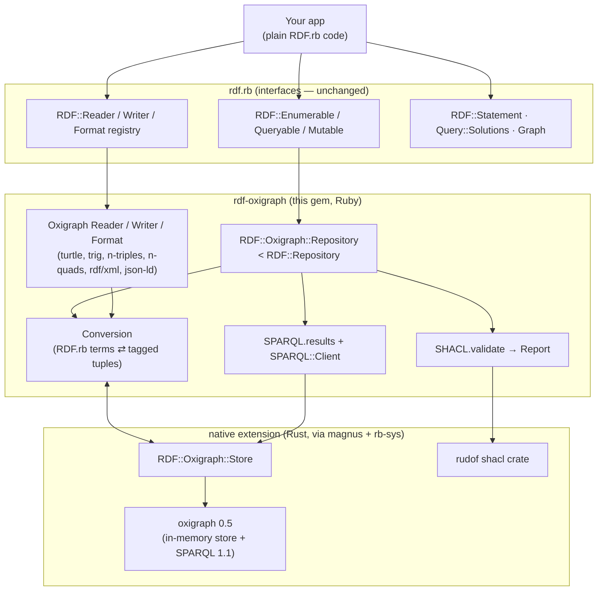

# rdf-oxigraph
🤖 Claude (Anthropic) helped writing this library. 

A Ruby gem providing a **drop-in [RDF.rb](https://github.com/ruby-rdf/rdf)-compatible**
storage + SPARQL backend powered by the
[oxigraph](https://github.com/oxigraph/oxigraph) Rust engine, via a
[magnus](https://github.com/matsadler/magnus) + [rb-sys](https://github.com/oxidize-rb/rb-sys)
native extension.

## Why

`RDF::Repository` ships with rdf.rb as a pure-Ruby, in-memory store, and SPARQL on top of
it (the `sparql` gem) is a pure-Ruby query engine. That's portable but slow, and SPARQL 1.1
coverage is uneven.

**rdf-oxigraph is a drop-in replacement for that backend.** It swaps the pure-Ruby store and
query engine for oxigraph — a fast, embedded, native **SPARQL 1.1** engine written in Rust —
while keeping the exact RDF.rb surface your code already uses. Existing rdf.rb /
`SPARQL::Client` consumers get the native engine **without changing their
code**: the only edit is which `Repository` class you instantiate.

What you get over the stock backend:

- Native SPARQL 1.1 **query + update** (SELECT/ASK/CONSTRUCT/DESCRIBE, full FILTER/REGEX/PREFIX).
- Native, fast **parse/serialize** for Turtle, TriG, N-Triples, N-Quads, RDF/XML, JSON-LD.
- In-process **SHACL validation** (oxigraph has none; provided via the rudof `shacl` crate).
- **Precompiled gems** — no Rust toolchain needed to install on the common platforms.

## Installation

Add to your `Gemfile`:

```ruby
gem "rdf-oxigraph"
```

or:

```bash
gem install rdf-oxigraph
```

Precompiled, platform-specific gems are published, so **no Rust toolchain is required to
install** on:

| Platform | Targets |
|----------|---------|
| Linux (glibc) | `x86_64-linux`, `aarch64-linux` |
| Linux (musl, Alpine, …) | `x86_64-linux-musl`, `aarch64-linux-musl` |
| macOS | `arm64-darwin` (Apple Silicon), `x86_64-darwin` (Intel) |

If no precompiled gem matches your platform, the gem falls back to **compiling from source**,
which requires a Rust toolchain (rustup recommended), Ruby headers, and clang/libclang.

> The extension uses oxigraph's **in-memory** store only (oxigraph built with
> `default-features = false`, no RocksDB / no C++). This keeps the gem small (~2.5 MB) and the
> Linux glibc/musl cross-builds reliable. On-disk persistence (`Store::open`) is intentionally
> not enabled — re-enable oxigraph's `rocksdb` feature in `ext/rdf_oxigraph/Cargo.toml` if you
> need it.

## Architecture — how it fits into rdf.rb

rdf.rb defines the *interface* (the `RDF::Enumerable` / `RDF::Queryable` / `RDF::Mutable`
mixins, plus the `RDF::Reader` / `RDF::Writer` / `RDF::Format` registries). The slow parts
are the *implementations*: the pure-Ruby in-memory store and the pure-Ruby SPARQL engine.

rdf-oxigraph keeps the interfaces and replaces the implementations. Your code talks to the
same rdf.rb objects (`RDF::Statement`, `RDF::Query::Solutions`, `RDF::Graph`); underneath,
calls cross a thin tagged-tuple bridge into the native oxigraph engine.



The native boundary is deliberately narrow: terms are marshalled as small tagged tuples
(e.g. `["uri", "..."]`, `["lit", value, datatype, lang]`), and SHACL crosses the boundary
only as serialized RDF strings.

## Usage

### Do I have to use `RDF::Oxigraph::Repository`?

**Yes — instantiating `RDF::Oxigraph::Repository` (or the lower-level
`RDF::Oxigraph::Store`) is the one and only thing you change.** That object *is* the
oxigraph-backed store; without it, your data lives in the stock pure-Ruby store and none of the
native speedups apply. Everything else stays standard rdf.rb:

```ruby
require "rdf/oxigraph"

repo = RDF::Oxigraph::Repository.new   # <-- the only oxigraph-specific line

# ...from here on it's plain RDF.rb — identical to stock RDF::Repository:
repo << RDF::Statement.new(subject, predicate, object)
repo.query([nil, RDF.type, RDF::URI("http://example.org/Person")])
repo.count
```

Two nuances:

- **Readers/Writers register globally.** Once `rdf/oxigraph` is required, the oxigraph-backed
  Turtle/TriG/N-Triples/N-Quads/RDF-XML/JSON-LD readers/writers are registered in rdf.rb's
  format registry. `RDF::Reader.for(...)` / `RDF::Writer.for(...)` and `Repository#load` /
  `#dump` then use the native parsers — no extra wiring.
- **SPARQL needs the repository.** `repo.sparql(...)`, `repo.sparql_update(...)`, and the
  `RDF::Oxigraph::SPARQL::Client` wrapper all run against the oxigraph store, so they require
  the oxigraph repository.

### Drop-in repository

The same rdf.rb code runs unchanged against the stock store and the oxigraph store with
identical results:

```ruby
require "rdf/oxigraph"

EX = RDF::Vocabulary.new("http://example.org/")
repo = RDF::Oxigraph::Repository.new
repo << RDF::Statement.new(EX.alice, RDF.type, EX.Person)
repo << RDF::Statement.new(EX.alice, EX.name, RDF::Literal("Alice"))

repo.query([nil, RDF.type, EX.Person]).each { |s| puts s.subject }
```

### Load & serialize (native parse/serialize)

```ruby
repo = RDF::Oxigraph::Repository.new
repo.load("data.ttl")            # native Turtle parse, straight into the store
puts repo.dump(:ntriples)        # native serialization
puts repo.dump(:jsonld)

RDF::Reader.for(content_type: "text/turtle")  # => oxigraph-backed reader
RDF::Writer.for(:ntriples)                    # => oxigraph-backed writer
```

### SPARQL query + update

```ruby
repo = RDF::Oxigraph::Repository.new
repo.load("data.ttl")

# SELECT -> RDF::Query::Solutions
repo.sparql("SELECT ?s WHERE { ?s a <http://example.org/Book> }").each { |sol| puts sol[:s] }

# ASK -> true/false ; CONSTRUCT/DESCRIBE -> RDF::Graph
repo.sparql("ASK { ?s ?p ?o }")
graph = repo.sparql("CONSTRUCT { ?a ?b ?c } WHERE { ?a ?b ?c }")

# SPARQL 1.1 Update
repo.sparql_update("INSERT DATA { <http://example.org/x> a <http://example.org/Book> }")

# SPARQL::Client-shaped wrapper (string-based query/update)
client = RDF::Oxigraph::SPARQL::Client.new(repo)
client.query("SELECT (COUNT(?s) AS ?n) WHERE { ?s ?p ?o }")
```

### SHACL validation

oxigraph itself has no SHACL; validation is provided in-process by the rudof
[`shacl`](https://crates.io/crates/shacl) crate (native, no external service):

```ruby
report = repo.shacl_validate(shapes_turtle_string)  # validate the repo's data
report.conforms?    # => true / false
report.violations   # => count
report.results      # => [{ "focus" => ..., "severity" => ..., "message" => ..., "path" => ... }, ...]
puts report.to_s    # human-readable report

# or validate two RDF strings directly, no repository needed:
RDF::Oxigraph::SHACL.validate(data: data_ttl, shapes: shapes_ttl)
```

### Runnable examples

The [`examples/`](examples/) directory has self-contained scripts (shared dataset in
`examples/data/books.ttl`). After `rake compile` (or installing the gem):

```bash
ruby -Ilib examples/01_drop_in_repository.rb   # drop-in: same code, stock vs oxigraph
ruby -Ilib examples/02_load_and_serialize.rb   # native load + serialize, format registry
ruby -Ilib examples/03_sparql.rb               # SELECT/ASK/CONSTRUCT + UPDATE + client
ruby -Ilib examples/04_shacl.rb                # SHACL validation
```

(Drop the `-Ilib` once the gem is installed.)

## Conformance & known deviations

`RDF::Oxigraph::Repository` passes **319/338** of the official `rdf-spec` `RDF::Repository`
shared examples (`rake conformance`). The other 19 stem from a single, documented backend
behavior, and are marked **pending** (see [spec/known_deviations.rb](spec/known_deviations.rb))
so the suite runs green:

- **oxigraph canonicalizes typed literals.** `"01"^^xsd:integer` is stored as
  `"1"^^xsd:integer`, and `"1.0e0"^^xsd:double` as its canonical form. rdf-spec treats
  distinct lexical forms as distinct terms, so the lexical-preservation / term-count /
  value-pattern tests fail. This is semantically reasonable (both denote the same value) and
  is harmless.
- `#dump` differs only in auto-assigned blank-node labels (the triples are identical).

These are inherent to oxigraph's value-based storage and are not fixable in the gem.

Marking them pending rather than ignoring the failures keeps the suite honest in both
directions:

- if a pending example ever **starts passing**, RSpec reports it as a failure
  (`Expected pending ... to fail`) — delete the entry from `known_deviations.rb`;
- if an entry stops matching because rdf-spec renamed the example, that example is no
  longer marked pending and fails normally, and `spec_helper.rb` prints a warning naming
  the stale entry.

So a real regression still turns CI red — only these 19 documented deviations are excused.

## Tests

Two suites:

- **Minitest** — the main suite and the default `rake` task:

  ```bash
  CARGO_TARGET_DIR="$HOME/.cargo-target/rdf-oxigraph" bundle exec rake test
  ```

- **RSpec** — runs only the `rdf-spec` conformance shared examples (which are RSpec-only):

  ```bash
  CARGO_TARGET_DIR="$HOME/.cargo-target/rdf-oxigraph" bundle exec rake conformance
  ```

Both are green: `rake conformance` reports `0 failures, 19 pending`, those 19 being the
documented deviations (see
[Conformance & known deviations](#conformance--known-deviations)). Both tasks depend on
`:compile`, so they rebuild the native extension first. Setting `CARGO_TARGET_DIR` keeps Rust
build artifacts out of Dropbox/source control (optional but recommended).

CI (`.github/workflows/ci.yml`) runs both suites across Ruby 3.1–3.4 on Linux and macOS.

## Compile (development)

```bash
bundle install

# Build the native extension into lib/rdf/oxigraph/:
CARGO_TARGET_DIR="$HOME/.cargo-target/rdf-oxigraph" bundle exec rake compile

# Smoke test:
ruby -Ilib -e 'require "rdf/oxigraph"; \
  r = RDF::Oxigraph::Repository.new; \
  r.sparql_update("INSERT DATA { <http://ex/a> <http://ex/b> <http://ex/c> }"); \
  puts r.sparql("ASK { ?s ?p ?o }")'
```

Requirements for compiling from source: Ruby >= 3.0 with headers, a Rust toolchain (rustup
recommended), and clang/libclang.

## Building & publishing the gem (Intel + ARM)

The pure-Ruby `gem build` produces a source gem (Rust compiled at install time). To ship
**precompiled, platform-specific** gems so users don't need Rust, build one gem per platform.

### Recommended: GitHub Actions (all platforms)

The [`precompile`](.github/workflows/precompile.yml) workflow uses
[`oxidize-rb/actions/cross-gem`](https://github.com/oxidize-rb/actions) to cross-compile gems
for every supported platform (Linux x86_64/arm64 glibc + musl, macOS arm64/x86_64) across Ruby
3.1–3.4. It triggers on a version tag or manually:

```bash
# Tag a release -> the workflow builds every platform gem and uploads them as artifacts:
git tag v0.0.1
git push origin v0.0.1
```

Download the artifacts and push them:

```bash
gem push rdf-oxigraph-0.0.1-arm64-darwin.gem
gem push rdf-oxigraph-0.0.1-x86_64-darwin.gem
gem push rdf-oxigraph-0.0.1-x86_64-linux.gem
gem push rdf-oxigraph-0.0.1-aarch64-linux.gem
gem push rdf-oxigraph-0.0.1-x86_64-linux-musl.gem
gem push rdf-oxigraph-0.0.1-aarch64-linux-musl.gem
```

> The gemspec sets `rubygems_mfa_required`, so `gem push` will prompt for your RubyGems OTP.

### Local cross-compilation (Intel + ARM)

Cross-compilation is Docker-based, via
[`rb-sys-dock`](https://github.com/oxidize-rb/rb-sys) — no per-platform machines needed. It
requires Docker (or Podman) running locally.

#### Easiest: `rake build` (interactive)

```bash
bundle exec rake build
```

This wraps `rb-sys-dock` with a menu: it lists every supported target, builds the one you
pick, and loops until you quit. It also handles the two footguns described below for you
(corrects symlinked paths, pins Ruby to `~> 3.0`). Override the Ruby pin with
`RUBY_VERSIONS=... bundle exec rake build` if you need to.

#### Manual: `rb-sys-dock` per platform

```bash
# macOS — Apple Silicon (arm64) and Intel (x86_64):
bundle exec rb-sys-dock --platform arm64-darwin   --ruby-versions "~> 3.0" --build
bundle exec rb-sys-dock --platform x86_64-darwin  --ruby-versions "~> 3.0" --build

# Linux — Intel + ARM (glibc and musl):
bundle exec rb-sys-dock --platform x86_64-linux       --ruby-versions "~> 3.0" --build
bundle exec rb-sys-dock --platform aarch64-linux      --ruby-versions "~> 3.0" --build
bundle exec rb-sys-dock --platform x86_64-linux-musl  --ruby-versions "~> 3.0" --build
bundle exec rb-sys-dock --platform aarch64-linux-musl --ruby-versions "~> 3.0" --build
```

Each build drops a `pkg/rdf-oxigraph-<version>-<platform>.gem`; push each with `gem push` as
above.

> **Two gotchas** (both handled automatically by `rake build`):
>
> - **Pin Ruby to `~> 3.0`.** The cross-compile image also ships a Ruby 4.0 target, but
>   `magnus 0.7` cannot compile against it (`no field 'typed_flag' on type RTypedData`). The
>   `--ruby-versions "~> 3.0"` flag builds for Ruby 3.0–3.4 and skips 4.0. (Plain `--build`
>   targets every Ruby in the image and fails on 4.0.)
> - **Don't launch from a symlinked path.** `rb-sys-dock` mounts the shell's `$(pwd)`
>   (symlinks *not* resolved) but runs the container in the resolved path. If you reached the
>   project through a symlink (e.g. `~/Sources -> …/Dropbox/AllSources`), the container's
>   working dir ends up empty — surfacing as `No Rakefile found` or `Could not locate Gemfile`.
>   `cd "$(pwd -P)"` first, or just use `rake build`.

A native gem for **your current machine only** (no Docker) is just:

```bash
CARGO_TARGET_DIR="$HOME/.cargo-target/rdf-oxigraph" bundle exec rake native gem
# => pkg/rdf-oxigraph-<version>-<your-platform>.gem
```

## License

MIT — see [LICENSE](LICENSE).
